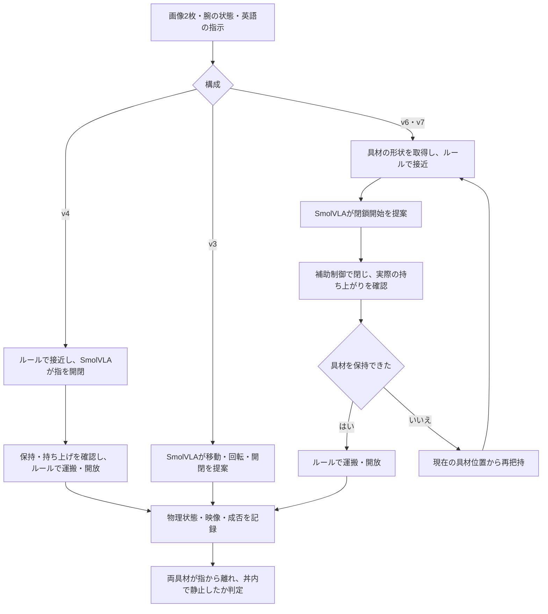

# SmolVLAによるラーメン盛り付け

- [📋 1. 概要とレポート](#-1-概要とレポート)
- [🎬 2. 比較動画と結果](#-2-比較動画と結果)
- [🚀 3. セットアップと実行](#-3-セットアップと実行)
- [📁 4. リポジトリ構成](#-4-リポジトリ構成)
- [🧪 5. 検証](#-5-検証)

## 📋 1. 概要とレポート

シミュレータ上のPandaアームで、左右のトレーにある卵・なるとをラーメン丼へ運ぶ。
学習済みSmolVLAの全推論から、剛体へのルール併用、軟体への接触補助制御へと比較する。
実験の説明と考察は [REPORT.md](REPORT.md)。実機・追加学習は不要。

| 構成 | 具材 | SmolVLAの担当 | 補助制御の担当 |
| --- | --- | --- | --- |
| [v3：全推論](v3-ramen-smolvla/README.md) | 剛体 | 手先の移動・回転・指の開閉 | 低レベルの関節制御と成功判定 |
| [v4：MuJoCo剛体](v4-hybrid-ramen/README.md) | 剛体 | 把持時の指の開閉 | 接近・姿勢保持・持ち上げ確認・運搬・開放 |
| [v6：MuJoCo軟体](v6-mujoco-soft/README.md) | flex弾性体 | 閉鎖開始の提案 | 接近・接触力を見た閉鎖・保持確認・運搬・開放・再把持 |
| [v7：ROS 2＋Genesis軟体](v7-ros-genesis-soft/README.md) | FEM弾性体 | 閉鎖開始の提案 | 接近・頂点の近接を見た閉鎖・保持確認・運搬・開放・再把持 |

麺とスープは固定形状。卵・なるとの弾性は実食品の測定値ではない。
軟体版の把持位置はシミュレータ内の頂点位置から求める。モデルの全動作による盛り付けではない。



接近と運搬の画像（v4の剛体実験）：

| 接近 | 運搬 |
| --- | --- |
|  |  |

## 🎬 2. 比較動画と結果

**[提出用動画：全推論 → 剛体成功 → 剛体失敗 → 軟体成功 → Genesis軟体失敗](results/soft-comparison/ramen-soft-comparison.mp4)**

長さは **2分21秒**（140.93秒）。代表5試行をシミュレーション時間の2倍速で収録する。選んだ各試行の途中区間は省略しない。

| 動画の順序 | 条件 | 結果・説明 |
| --- | --- | --- |
| 1 | 全推論・剛体、seed 42 | 両具材をつかめず |
| 2 | MuJoCo剛体・ルール＋推論、seed 42 | 両具材が成功 |
| 3 | MuJoCo剛体・ルール＋推論、seed 43 | なるとを運搬中に落とす。今回の3試行中1回で失敗 |
| 4 | MuJoCo軟体・接触補助制御、seed 42 | 両具材が成功。今回の3試行すべて成功 |
| 5 | Genesis軟体・接触補助制御、seed 42 | 卵は持ち上がらず、なるとは開放できず |

剛体の集計はseed 42・43・44で成功2/3、失敗1/3。軟体の集計は同じ3つのseedで成功3/3。
動画に出していない剛体seed 44と軟体seed 43・44も、元の動画・設定・判定を保存する。
どの試行も実際のSmolVLA推論を含む。MuJoCoはCPU・ray描画、GenesisはMetal・MPSを使用する。

軟体化と同時に把持・保持制御も変えており、軟体化だけの効果を調べた実験ではない。
成功率・失敗率は今回の3試行ずつの実測値であり、一般的な確率ではない。
シミュレータ間でも変形モデル・接触判定・描画・計算装置が異なる。

- **個別動画**：[5つの代表例の説明付き動画](results/soft-comparison/videos/)。
- **元の記録**：[全8試行の等速動画・設定・判定・時系列ログ](results/soft-comparison/evidence/)。
- **実験情報**：[試行別結果・3試行ずつの集計・ソース照合情報](results/soft-comparison/experiment-manifest.json)、[動画内の開始位置](results/soft-comparison/chapters.json)。
- **剛体実験の記録**：[全推論＋剛体ハイブリッド3回](results/ramen-comparison/)。

## 🚀 3. セットアップと実行

### 3.1. 必要な環境

- **共通**：Python 3.12、uv、H.264対応のffmpeg。モデル初回取得にはインターネット接続が必要。APIキーは不要。
- **Genesis**：Docker、`docker-compose`、ROS 2コンテナ。Macでは通常のTerminalから起動する。
- **GPU**：Apple SiliconのMetal・MPS。MuJoCoの提出映像はCPU・ray描画で生成。

各構成は独立したPythonプロジェクト。以下はこのREADMEのあるディレクトリを起点とする。
依存は各 `uv.lock` で固定する。設定は必須項目を含む `.env.example` から用意する。
`FFMPEG_PATH` は `command -v ffmpeg` で確認した絶対パスに合わせる。
`HF_HOME=../.cache/huggingface` はこのリポジトリ内の共有モデルキャッシュを指す。

### 3.2. MuJoCo軟体：3配置

```sh
cd v6-mujoco-soft
uv sync --locked
cp -n .env.example .env
command -v ffmpeg
```

`.env` の `FFMPEG_PATH` を確認してから実行する。

```sh
for trial_seed in 42 43 44; do
  POLICY_MODE=smolvla DEVICE=cpu RENDERER=ray SEED="$trial_seed" uv run python src/main.py
done
```

GPU・native描画は `./run_gpu.command`。提出動画とは描画・計算装置が異なる。
`POLICY_MODE=mechanics` はAIなしの機械診断であり、提出動画の3試行には使用しない。

### 3.3. ROS 2＋Genesis軟体

リポジトリのルートから実行する。

```sh
cd v7-ros-genesis-soft
uv sync --locked
cp -n .env.example .env
command -v ffmpeg
```

`.env` の `FFMPEG_PATH` を確認する。Colimaの場合、通常のTerminalで次を実行する。

```sh
colima start --cpu 4 --memory 4
./run_gpu.command
```

ROSサーバー・接続確認・Genesis・制御プロセスが起動する。
ROSブリッジは `127.0.0.1:9091`、GenesisはMetal、SmolVLAはMPSで動作する。
初回コンパイルには時間がかかる。Genesisのログは `output/simulation-*.log`、推論・工程のログはTerminalに出力する。
ROSサーバーの停止は `docker-compose down`。

### 3.4. MuJoCo剛体：ルール＋推論

リポジトリのルートから実行する。

```sh
cd v4-hybrid-ramen
uv sync --locked
cp -n .env.example .env
command -v ffmpeg
```

`.env` の `FFMPEG_PATH` を確認してから3配置を実行する。

```sh
for trial_seed in 42 43 44; do
  DEVICE=cpu RENDERER=ray SEED="$trial_seed" uv run python src/main.py
done
```

### 3.5. 全推論

```sh
cd v3-ramen-smolvla
uv sync --locked
cp -n .env.example .env
command -v ffmpeg
```

`.env` の `FFMPEG_PATH` を確認後、提出動画と同じ条件で実行する。

```sh
DEVICE=cpu RENDERER=ray SEED=42 uv run python src/main.py
```

## 📁 4. リポジトリ構成

```text
.
├─ README.md                          # 実行方法と成果物
├─ REPORT.md                          # 簡潔な実験レポート
├─ .gitignore                         # ローカル設定・キャッシュの除外
├─ .pre-commit-config.yaml             # 各構成の整形・Lint
├─ image/                             # 剛体版の参考スクリーンショット
├─ v3-ramen-smolvla/                   # 全推論
├─ v4-hybrid-ramen/                    # 剛体ハイブリッドの成功・失敗例
├─ v6-mujoco-soft/                     # MuJoCo軟体と接触補助制御
├─ v7-ros-genesis-soft/                # ROS 2・Genesis軟体と補助制御
└─ results/
   ├─ soft-comparison/
   │  ├─ ramen-soft-comparison.mp4    # 提出用の代表5試行比較
   │  ├─ chapters.json               # 試行ごとの開始位置
   │  ├─ experiment-manifest.json    # 条件・成否・集計・SHA-256
   │  ├─ videos/                     # 説明付き個別動画
   │  ├─ figures/                    # 各試行の最終画像
   │  └─ evidence/                   # 等速の元映像と実験ログ
   └─ ramen-comparison/              # 剛体版の参考実験
```

各プロジェクトに `pyproject.toml`、`uv.lock`、`.env.example`、`src/`、`tests/`、`input/`、`assets/` と詳細READMEを含む。
GenesisにはROS用の `Dockerfile`、`compose.yaml`、`start_ros.command` も含む。
`.env`、仮想環境、モデルキャッシュ、実行ごとの `output/` はGitの管理対象外。

## 🧪 5. 検証

対象プロジェクトのディレクトリで実行する。

```sh
uv run pytest tests -v --cov=src --cov-report=term
uv run ruff format --check src tests
uv run ruff check src tests
uv run mypy src tests --follow-imports=silent
```

単体テストと実モデルの盛り付け結果は別に評価する。
このディレクトリをGitリポジトリのルートにした場合、次のコマンドでコミット時の整形・Lintを有効にできる。

```sh
uv run --locked --project v6-mujoco-soft pre-commit install
```
# physicalai-advanced1-exam-public
