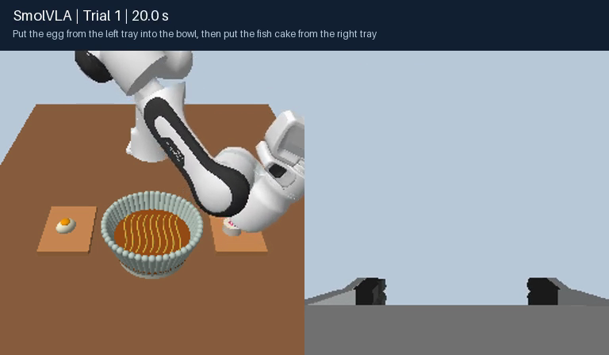
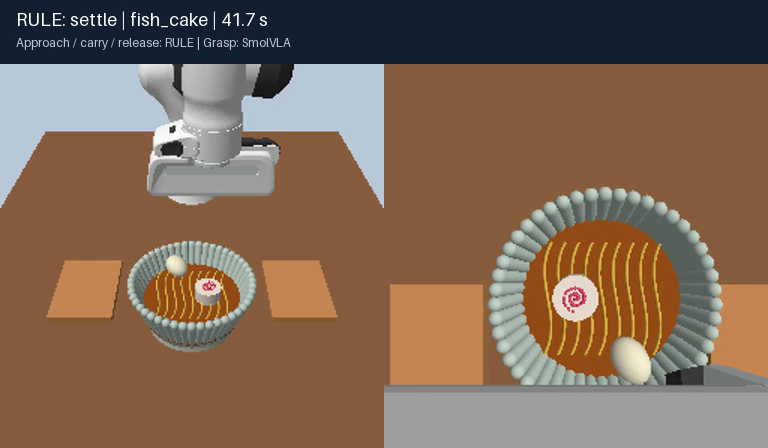
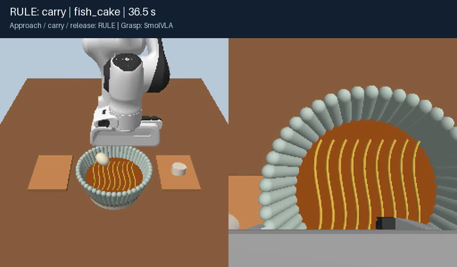
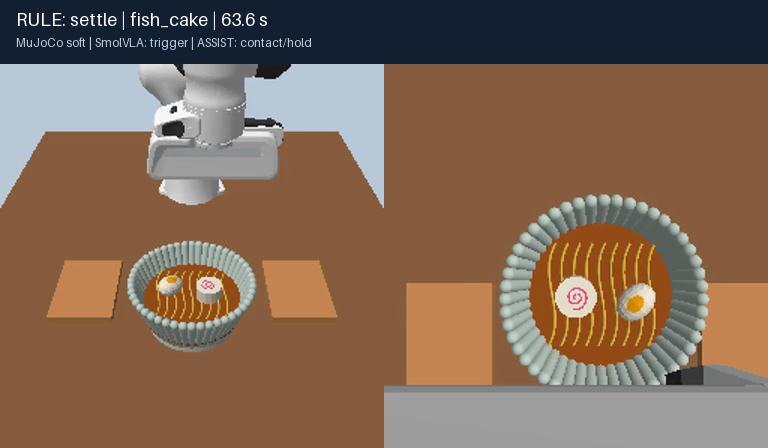
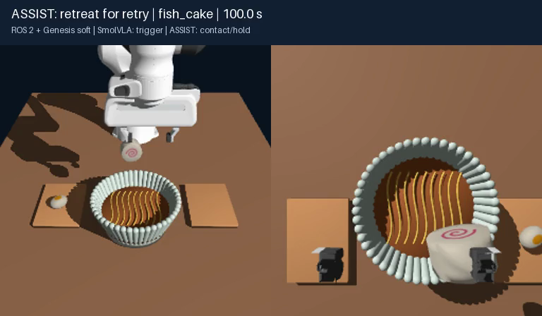

# SmolVLAを使ったラーメンの盛り付け

### 環境・タスク

- モデル：SmolVLA（`HuggingFaceVLA/smolvla_libero`、追加学習なし）、LeRobot 0.6.1。
- シミュレータ：MuJoCo 3.15.0／Genesis 1.4.3。GenesisはROS 2 Jazzy経由で制御。
- 実機は使わず、Apple M4 Pro・メモリ48GB上のPandaアームで、左右のトレーから卵となるとを丼へ運ぶ。
- MuJoCoはCPU推論・ray描画、GenesisはMetalで物理計算・MPSで推論。
- 軟体版の卵・なるとは変形する弾性体。ただし実食品の物性を計測したモデルではなく、麺とスープは固定形状。

### 1. 剛体・全推論

- カメラ画像2枚、腕の状態、英語の指示をモデルに入力する。
- 手先の移動・回転・指の開閉をモデルに任せたが、20秒間で卵もなるともつかめなかった。

### 2. MuJoCo剛体・成功例

- 具材の位置をシミュレータから取得し、接近・姿勢保持・運搬・開放をルール制御にする。
- SmolVLAには、つかむ位置での指の開閉を任せる。
- seed 42では、卵となるとの両方を盛り付けられた。

### 3. MuJoCo剛体・失敗例

- seed 43では卵は成功したが、なるとを持ち上げた後、運搬中に落とした。
- seed 42・43・44の **3試行中1回が失敗（失敗率1/3）**。成功は2/3だった。
- 具材は剛体なので、柔らかさによる失敗ではない。接触位置や保持力など、原因の切り分けが必要。

### 4. MuJoCo軟体・成功例

- 具材をflex弾性体にし、変形後の形状から把持位置と指の向きを決める。
- SmolVLAは閉鎖開始を提案。補助制御で接触力を見ながら閉じ、保持を監視して運ぶ。失敗時は再把持する。
- seed 42・43・44の **3試行すべて成功（成功率3/3）**。具材6個すべて、再把持なしで盛り付けられた。
- 3試行とも実際のSmolVLA推論を含む。動画ではseed 42を代表例として示す。

### 5. Genesis軟体・失敗例

- ROS 2経由でGenesisのFEM弾性体を操作する。SmolVLAはMuJoCo軟体版と同じモデルを使う。
- 指腹と頂点の近接を把持の目安にし、実際に持ち上がることも確認する。指の駆動力は接触力とは区別する。
- 卵は3回把持を試したが持ち上がらなかった。
- なるとは丼の上まで運べたが、指を開いても手先付近に残った。丼に置いて静止する条件を満たさず、失敗だった。

### まとめ

- 全推論ではつかめなかったが、ルール制御を併用した剛体版では2/3、接触補助制御を加えた軟体版では3/3が成功した。
- 軟体化と同時に把持・保持の制御も変えているため、軟体にしただけで成功率が上がったとは言えない。
- Genesisでは、把持だけでなく指から確実に離す制御にも課題が残った。
- 成否は今回の少数試行の実測値であり、一般的な成功率ではない。シミュレータ間でも変形モデル・接触判定・描画・計算装置が異なる。

[比較動画（2分21秒・代表5試行・2倍速）](results/soft-comparison/ramen-soft-comparison.mp4) ／ [全試行の条件・結果](results/soft-comparison/experiment-manifest.json) ／ [実行手順](README.md)
