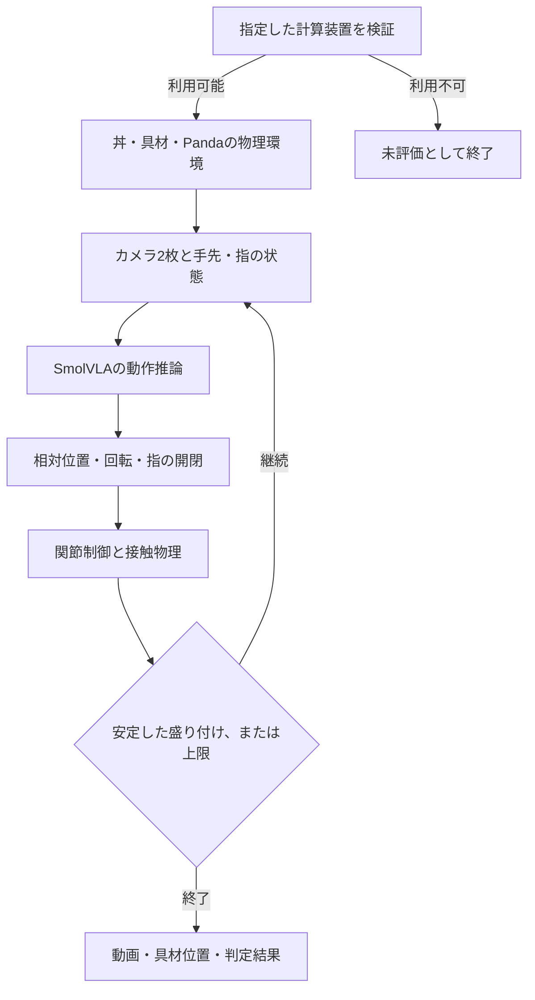

# SmolVLAによるラーメン盛り付けの評価

- [📋 1. 実験仕様](#-1-実験仕様)
- [🚀 2. ローカル実行](#-2-ローカル実行)
- [⚙️ 3. 設定](#️-3-設定)
- [📁 4. 出力と構成](#-4-出力と構成)
- [🧪 5. 検証](#-5-検証)

## 📋 1. 実験仕様

麺とスープが入った丼の左右に卵となるとを置き、Pandaアームによる盛り付けを評価する。
左右の具材は位置と向きがシードに応じて変わる。麺とスープは固定形状で、流体・非剛体の運動は対象外。
具材は重力と接触に従う剛体。具材を移動先へ直接配置する制御は含まれない。

- **ロボット**: MuJoCo MenagerieのPanda。モデルとライセンスは `assets/franka_emika_panda/`。
- **器と具材**: MuJoCoの標準形状による簡略モデル。器は底と側面を持つ。
- **入力**: 場面の実際のカメラ画像2枚、手先の位置・姿勢、指の状態、自然言語指示。
- **画像座標**: 表示画像は上原点。方策へ渡す画像は左右を反転した座標に対応する。
- **姿勢**: 状態量の姿勢はhand座標系。制御サイトはhandからローカルZ軸で−90度の座標系。
- **グリッパ**: 正の指令で閉じ、負の指令で開き、ゼロでは開き幅を維持する。
- **方策**: LIBERO向け学習済みSmolVLA。ラーメン用の追加学習を含まない。
- **制御**: モデルが返す7次元の相対手先動作を、Pandaの関節目標とグリッパ指令へ変換する。
- **評価**: 両方の具材が丼内の所定の高さで静止し、手先から離れた状態を10制御周期維持する。
- **制御周期**: 20Hz。設定例の400ステップはシミュレーション20秒。

この場面はLIBERO標準タスクではなく、カメラ・物体・制御器も学習時と同一ではない。
結果は、この構成に対する学習済みモデルの適用試験として扱う。
盛り付けの成功保証や、モデル一般の性能評価を意味しない。



## 🚀 2. ローカル実行

### 2.1. Apple Silicon GPU

Macの通常のターミナルで実行する。

```bash
cd v3-ramen-smolvla
uv sync --locked
cp -n .env.example .env
./run_gpu.command
```

起動ファイル（`run_gpu.command`）は `DEVICE=mps` と `RENDERER=native` を指定する。
Metalを利用できない場合は終了し、CPUへの自動切り替えは行わない。
ネイティブ描画には、macOSのグラフィックス機能へアクセスできるプロセスが必要。
モデルはローカルで推論し、初回の公開重み取得以外に外部APIを使用しない。

### 2.2. CPUでの診断

```bash
DEVICE=cpu RENDERER=ray uv run python src/main.py
```

`ray` はMuJoCoの形状への光線追跡から画像を得る診断用描画。
固定画像やゼロ画像ではなく、アームと具材の現在位置を反映する。
照明や表面表現はネイティブ描画と異なるため、両方式の評価を区別する。
動画はシミュレーション時間に対して等速で、実際の計算速度を示すものではない。

## ⚙️ 3. 設定

全項目が必須。環境変数は `.env` より優先される。

| 変数 | 内容 |
| --- | --- |
| `DEVICE` | `mps` または `cpu` |
| `RENDERER` | `native` または `ray` |
| `MODEL_ID` | 学習済みモデルの公開識別子 |
| `MODEL_REVISION` | 固定したモデルのリビジョン |
| `HF_HOME` | モデルのキャッシュ。リポジトリ直下の `.cache/huggingface` を両バージョンで共有 |
| `OUTPUT_DIR` | 実行結果の保存先 |
| `LOG_LEVEL` | `DEBUG` / `INFO` / `WARNING` / `ERROR` |
| `SEED` | 配置と推論の乱数シード |
| `MAX_STEPS` | 制御ステップ上限 |
| `ACTION_STEPS` | 観測を再解釈するまでの動作数 |
| `DENOISING_STEPS` | 動作生成の拡散ステップ数 |
| `INSTRUCTION_FILE` | 自然言語指示のUTF-8ファイル |
| `FFMPEG_PATH` | H.264エンコーダを持つffmpegの実行ファイル |

設定例は英語の指示を使用する。学習時とは異なる言語の精度は、この実験の評価対象外。
設定やGPUの利用可否のエラーは終了コード1。
物理タスクが失敗しても、上限まで評価できた場合は結果を保存して終了コード0。

## 📁 4. 出力と構成

### 4.1. 実行結果

出力先は `output/YYYYMMDD-HHMMSS/`。日時はJST。

| ファイル | 内容 |
| --- | --- |
| `device.json` | このプロセスから見えるMetalとMPSの状態 |
| `settings.json` | 装置・描画方式・モデル・シード・制御条件 |
| `rollout.png` | 試行開始時の実観測 |
| `model_input.png` | 試行開始時に方策へ渡す画像座標での観測 |
| `rollout.mp4` | 全制御ステップのカメラ観測 |
| `progress.json` | 途中の制御番号と具材の位置 |
| `telemetry.jsonl` | 各ステップの動作、状態量、手首カメラの光軸と視野内判定 |
| `results.json` | 実験の実行有無、成功判定、使用装置、具材の実位置 |

`physical_task_evaluated=false` は、物理タスクを実行できなかったことを表す。
実行済みの評価結果は `result.success`。`ingredients` に具材ごとの `served` と `lifted` を含む。
`device` は指定装置、`parameter_device` はモデルのパラメータが配置された装置。
指示文は動画と結果に含むため、個人情報や秘密情報を記載しない。
`food_in_wrist_frustum` は具材の中心がカメラの画角内にあるかを示し、遮蔽物による見え方は含まない。

### 4.2. 構成

```text
v3-ramen-smolvla/
├─ pyproject.toml                 # 依存関係と品質ツール
├─ uv.lock                        # 固定バージョン
├─ .env.example                   # 設定テンプレート
├─ .env                           # ローカル設定
├─ README.md                      # 実験仕様
├─ run_gpu.command                # Metal GPUでの起動
├─ input/
│  └─ instruction.txt             # 盛り付け指示
├─ assets/
│  ├─ manifest.json               # モデルのリビジョンとファイル一覧
│  └─ franka_emika_panda/
│     ├─ LICENSE                  # Pandaモデルの利用条件
│     ├─ panda.xml                # ロボットの物理モデル
│     └─ assets/                  # マニフェストに対応するメッシュ群
├─ src/
│  ├─ __init__.py
│  ├─ main.py                     # 起動処理
│  ├─ pipeline.py                 # フル実行と結果保存
│  ├─ recording.py                # カメラ動画
│  ├─ config/
│  │  ├─ __init__.py
│  │  ├─ settings.py              # 必須設定
│  │  └─ logging.py               # JSONログ
│  ├─ policy/
│  │  ├─ __init__.py
│  │  └─ smolvla.py               # 学習済みモデル
│  ├─ environment/
│  │  ├─ __init__.py
│  │  ├─ scene.py                 # 器・麺・スープ・具材
│  │  ├─ camera.py                # ネイティブ描画とCPU診断描画
│  │  ├─ control.py               # 相対手先動作の制御
│  │  └─ ramen.py                 # 物理環境と盛り付け判定
│  └─ experiment/
│     ├─ __init__.py
│     ├─ types.py                 # 観測と動作の契約
│     ├─ observations.py          # 姿勢表現
│     └─ runner.py                # 閉ループ実行
├─ tests/
│  ├─ __init__.py
│  ├─ conftest.py                 # 物理環境のテスト設定
│  ├─ test_environment.py         # カメラ・接触・盛り付け判定
│  ├─ test_alignment.py           # 画像座標・初期姿勢・開閉指令
│  └─ test_pipeline.py            # GPU利用不可時の停止
└─ output/                        # 実測結果
```

## 🧪 5. 検証

```bash
uv run pytest tests -v --cov=src --cov-report=term
uv run ruff check src tests
uv run ruff format --check src tests
uv run mypy src tests --follow-imports=silent
uv run bandit -r src -lll
```

単体テストは物理状態の有限性、画像の生成、初期位置の失敗判定、安定配置の継続、GPUの暗黙切り替えの禁止を検証する。
テストの成功と、学習済みモデルによる盛り付けの成功は別の結果として扱う。
