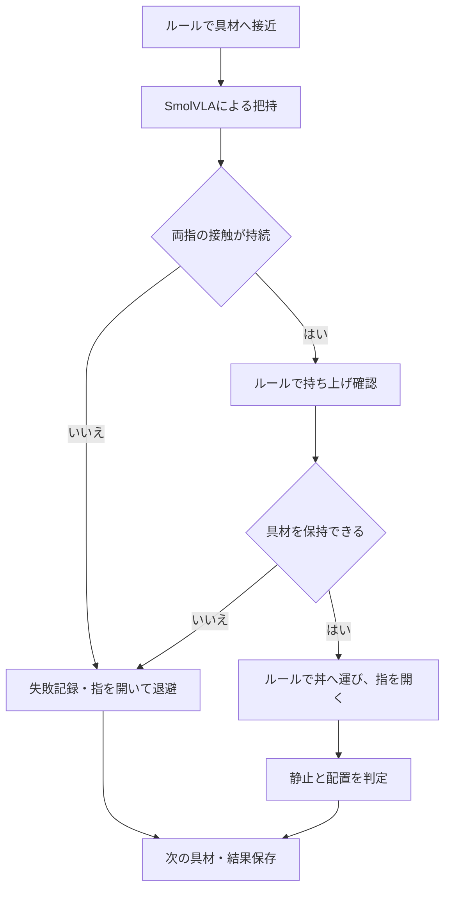

# ルール移動と推論把持によるラーメン盛り付け

- [📋 1. 制御の分担](#-1-制御の分担)
- [🚀 2. 実行](#-2-実行)
- [⚙️ 3. 設定と入力](#️-3-設定と入力)
- [📁 4. 出力と構成](#-4-出力と構成)
- [🧪 5. 検証](#-5-検証)

## 📋 1. 制御の分担

Pandaアームが、左右にある卵となるとを、麺とスープが入った丼へ運ぶ。
物体は剛体で、麺とスープは固定の支持面・表示形状。配置の位置と角度はシードで変わる。

| 区間 | 制御主体 | 挙動 |
| --- | --- | --- |
| 具材へ接近 | ルール | 現在位置をシミュレータから取得し、指を開いて接近 |
| 把持 | SmolVLA | 現在のカメラ画像と腕の状態から開閉指令を得る |
| 把持の確認 | ルールと物理判定 | 左右の指の接触を確認し、10cmの持ち上げで保持を検証 |
| 丼へ運ぶ | ルール | 推論で得た指の開き目標を維持して移動 |
| 放す | ルール | 丼の上で指を開き、重力によって具材を落とす |
| 成功判定 | 物理判定 | 具材全体が丼の開口部内に収まり、手先から離れて静止 |

### 1.1. 推論の範囲

`GRASP_CONTROL=gripper` は、SmolVLAの出力のうち指の開閉だけを使用する。
手先の位置・姿勢はルールで保持するため、把持位置を推論する実験とは異なる。
正の指令は閉じる、負の指令は開く、ゼロは開き幅を維持する。

`GRASP_CONTROL=pose` は、最終接近の位置・回転・開閉をモデルに任せる。
具材付近の目標から8cm以上離れた場合は失敗として終了する。

モデルがつかめない場合、固定の閉じる指令で成功へ置き換える処理は含まれない。
把持失敗・持ち上げ失敗の具材は運搬せず、指を開いて退避する。

### 1.2. 物理条件と成功判定

- **ロボット**: MenagerieのPanda。アームは重力下の姿勢保持に対応する。
- **グリッパ**: 位置制御で、力の上限はアクチュエータで40N。閉じるタイミングはモデルの指令に対応する。
- **具材**: 剛体の卵となると。滑り摩擦係数は3。実食品の物性同定を目的とする設定ではない。
- **接近点**: 具材中心より設定値だけ高い把持点。設定例は5mm。
- **接触候補**: 左右の指と対象の圧縮接触が3制御周期続く。
- **持ち上げ確認**: 具材が6cm以上上がり、手先近くで左右の指との接触を保持する。
- **配置確認**: 具材の外接半径まで含めて丼の開口部内に収まり、手先から離れ、10制御周期以上静止する。
- **全体の成功**: 両具材の各工程に成功し、最後の時点でも両具材が丼内で静止する。



## 🚀 2. 実行

### 2.1. MacのGPU

Macの通常のターミナルから実行する。

```bash
cd v4-hybrid-ramen
uv sync --locked
cp -n .env.example .env
./run_gpu.command
```

`run_gpu.command` は `DEVICE=mps` と `RENDERER=native` を指定する。
GPUが利用できなければエラーで停止する。CPUへの自動切り替えは行わない。
モデルの初回取得には通信が必要。推論はローカルで、APIキーは不要。

### 2.2. CPUでの診断

```bash
DEVICE=cpu RENDERER=ray uv run python src/main.py
```

CPUの `ray` 描画と通常の `native` 描画は、照明や表面表現が異なる。
実行装置と描画方式は結果ファイルに含む。

## ⚙️ 3. 設定と入力

全設定は必須。環境変数は `.env` より優先される。

| 設定 | 内容 |
| --- | --- |
| `DEVICE` | `mps` / `cpu` |
| `RENDERER` | `native` / `ray` |
| `MODEL_ID` / `MODEL_REVISION` | 固定した公開SmolVLAの識別子とリビジョン |
| `HF_HOME` | モデルのキャッシュ。リポジトリ直下の `.cache/huggingface` を両バージョンで共有 |
| `OUTPUT_DIR` | 実行結果の保存先 |
| `LOG_LEVEL` | `DEBUG` / `INFO` / `WARNING` / `ERROR` |
| `SEED` | 配置と推論の乱数シード |
| `GRASP_CONTROL` | `gripper` / `pose` |
| `GRASP_MAX_STEPS` | 具材ごとの推論区間の制御ステップ上限 |
| `APPROACH_CLEARANCE` | 具材中心から接近点までの高さ、メートル |
| `RULE_MOVE_SECONDS` | ルールによる各移動の時間、秒 |
| `ACTION_STEPS` | モデルを再推論するまでの制御動作数 |
| `DENOISING_STEPS` | 動作生成の拡散ステップ数 |
| `TASK_FILE` | 対象と把持指示を並べたJSONファイル |
| `FFMPEG_PATH` | H.264出力に対応するffmpeg |

入力ファイル（`input/tasks.json`）の対象は `egg` と `fish_cake`。
重複のない1〜2個の対象を実行順に指定する。
指示はモデルに渡すための把持指示で、追加学習用のデータではない。

## 📁 4. 出力と構成

### 4.1. 出力

実行ごとの `output/YYYYMMDD-HHMMSS/` に保存する。日時はJST。

| ファイル | 内容 |
| --- | --- |
| `device.json` | GPU利用可否 |
| `settings.json` | 制御条件 |
| `rollout.mp4` | 区間を `RULE` / `MODEL` と表示する全試行動画 |
| `telemetry.jsonl` | 制御主体、対象、モデルの全出力、実際に使った指令、接触状態 |
| `results.json` | 具材ごとの把持・持ち上げ・配置結果と失敗理由 |

`inference_steps` は、モデル出力を使用した制御ステップ数。
`raw_model_action` は7次元のモデル出力、`action` は物理環境に適用する指令。
ルール区間の `action` は `null`。
成功は `success` と具材ごとの `results` で確認する。終了コード0だけでは盛り付け成功を意味しない。

### 4.2. 構成

```text
v4-hybrid-ramen/
├─ pyproject.toml
├─ uv.lock
├─ .env.example
├─ .env                           # ローカル設定
├─ README.md
├─ run_gpu.command                # Metal GPUでの実行
├─ input/
│  └─ tasks.json                  # 対象と把持指示
├─ assets/
│  ├─ manifest.json               # Pandaのモデル情報
│  └─ franka_emika_panda/
│     ├─ LICENSE
│     ├─ panda.xml
│     └─ assets/                  # マニフェストのメッシュ群
├─ src/
│  ├─ __init__.py
│  ├─ main.py
│  ├─ pipeline.py                 # フル実行と記録
│  ├─ recording.py                # 制御主体を表示する動画
│  ├─ config/
│  │  ├─ __init__.py
│  │  ├─ settings.py
│  │  └─ logging.py
│  ├─ policy/
│  │  ├─ __init__.py
│  │  └─ smolvla.py               # 学習済みの把持方策
│  ├─ environment/
│  │  ├─ __init__.py
│  │  ├─ scene.py                 # 物理モデル
│  │  ├─ camera.py                # カメラ観測
│  │  ├─ control.py               # 相対指令と絶対目標の制御
│  │  └─ ramen.py                 # 接触と配置判定
│  └─ experiment/
│     ├─ __init__.py
│     ├─ types.py
│     ├─ observations.py
│     └─ hybrid.py                # ルールと方策の状態遷移
├─ tests/
│  ├─ __init__.py
│  ├─ conftest.py
│  ├─ test_alignment.py           # 観測・グリッパの契約
│  ├─ test_environment.py         # カメラ・接触・配置判定
│  └─ test_hybrid.py              # 把持失敗時の運搬禁止
└─ output/
```

## 🧪 5. 検証

```bash
uv run pytest tests -v --cov=src --cov-report=term
uv run ruff check src tests
uv run ruff format --check src tests
uv run mypy src tests --follow-imports=silent
uv run bandit -r src -lll
```

機械的な動作の検証用に固定の開閉指令を使うテストは、学習済みモデルの成功率とは区別する。
方策の成功評価には、モデル本体から出た指令と物理的な持ち上げ・配置判定を使用する。
