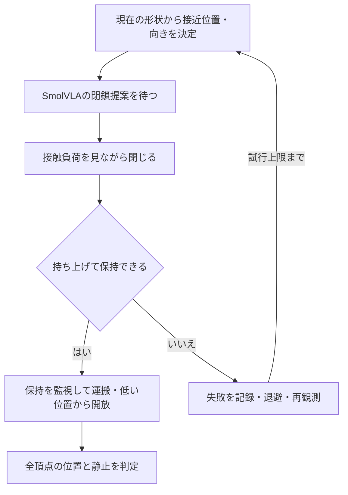

# 柔軟な具材の盛り付け：MuJoCo

- [📋 1. タスクと制御](#-1-タスクと制御)
- [🚀 2. 実行](#-2-実行)
- [⚙️ 3. 柔軟物と把持の設定](#️-3-柔軟物と把持の設定)
- [🎬 4. 実測結果](#-4-実測結果)
- [📁 5. 構成と出力](#-5-構成と出力)
- [🧪 6. 検証](#-6-検証)

## 📋 1. タスクと制御

左右のトレーにある柔軟な卵・なるとを、Pandaアームで丼へ運ぶ。
MuJoCo 3.15.0の弾性flexを使用する。各具材は99頂点で、圧縮とせん断をtrilinearの自由度で表す。
実食品の物性測定を目的とするモデルではない。麺とスープは固定形状。

- **AI**：SmolVLAが指の閉鎖開始を提案する。追加学習は含まない。
- **接近**：変形した頂点群から短軸と把持位置を求め、指先がトレーに当たらない高さへ移動する。
- **閉鎖**：左右の指とflexの接触力を確認しながら少しずつ閉じる。推論の提案がなくても、設定した待ち時間後に補助制御へ進む。
- **保持**：持ち上げて確認し、運搬中に負荷が弱まれば閉じ直す。過大な変形や把持の喪失は失敗として記録する。
- **開放**：丼の上で低い位置まで下ろしてから指を開く。
- **再試行**：失敗時は指を開いて退避し、その時点の具材位置から再把持する。



## 🚀 2. 実行

Python 3.12、uv、H.264対応のffmpegが必要。

```sh
cd v6-mujoco-soft
uv sync --locked
cp -n .env.example .env
command -v ffmpeg
```

`.env` の `FFMPEG_PATH` を表示されたパスに合わせる。`HF_HOME` には既存のモデルキャッシュも指定できる。

通常のTerminalからApple GPUで推論・native描画を使う場合：

```sh
./run_gpu.command
```

CPU推論・ray描画で実モデルを使う場合：

```sh
DEVICE=cpu RENDERER=ray POLICY_MODE=smolvla uv run python src/main.py
```

AIを使わない機械動作の診断：

```sh
DEVICE=cpu RENDERER=ray POLICY_MODE=mechanics uv run python src/main.py
```

`mechanics` の結果は `policy_evaluated=false`。画像・モデルを使う実験とは区別する。
ray描画も、物理計算された変形後の表面三角形を使用する。native描画とは照明や材質表現が異なる。

## ⚙️ 3. 柔軟物と把持の設定

全項目が必須。説明と値は [`.env.example`](.env.example) に記載する。

| 設定 | 意味 |
| --- | --- |
| `YOUNG_MODULUS_PA` / `POISSON_RATIO` | 弾性の硬さと体積変化 |
| `ELASTIC_DAMPING` / `SOFT_MASS_KG` | 減衰と具材の質量 |
| `MODEL_PROPOSAL_STEPS` | AIの閉鎖提案を待つ長さ |
| `CLOSE_STEP` | 一周期の閉じる量 |
| `GRIP_LOAD_TARGET` / `GRIP_LOAD_LIMIT` | 把持負荷の目標と閉鎖停止の目安 |
| `MAX_COMPRESSION` | 観測した幅に対する目標開き幅の下限 |
| `MAX_DEFORMATION_RMS` | 剛体移動を除いた形状変化の上限 |
| `APPROACH_CLEARANCE` | 指先と具材最下面の間隔 |
| `MAX_ATTEMPTS` / `SETTLE_STEPS` | 再試行回数と静止確認の上限 |

変形RMSは、初期形状との位置・回転の差を除いた頂点位置の差。
「幅の圧縮率」は指令の制限であり、食品の損傷限界を意味しない。
把持位置はシミュレータの頂点位置を使う。画像だけでの位置推定ではない。

## 🎬 4. 実測結果

CPU推論・ray描画、seed 42、SmolVLAと接触補助制御を使用した一試行。

| 具材 | 結果 | 把持試行 | 最大変形RMS |
| --- | --- | --- | --- |
| 卵 | 盛り付け成功 | 1回 | 約0.71mm |
| なると | 盛り付け成功 | 1回 | 約1.66mm |

両具材でSmolVLAの閉鎖提案があり、その後の閉鎖と保持は補助制御が担当した。
一試行の結果であり、一般的な成功率や実食材への適用精度を示すものではない。

[動画（63.65秒）](../results/soft-comparison/evidence/mujoco-42/rollout.mp4) ／ [結果](../results/soft-comparison/evidence/mujoco-42/results.json) ／ [実行条件](../results/soft-comparison/evidence/mujoco-42/settings.json)


## 📁 5. 構成と出力

```text
v6-mujoco-soft/
├─ README.md
├─ pyproject.toml
├─ uv.lock
├─ .env.example
├─ .gitignore
├─ .pre-commit-config.yaml
├─ run_gpu.command
├─ assets/
│  ├─ manifest.json
│  ├─ franka_emika_panda/         # Panda形状と利用条件
│  └─ soft_food/                 # 頂点・要素・表面模様・OBJ
├─ input/
│  └─ tasks.json                 # 対象と指示
├─ src/
│  ├─ main.py
│  ├─ pipeline.py                # 推論と診断の実行・記録
│  ├─ recording.py               # 動画
│  ├─ config/                    # settings.py・logging.py
│  ├─ environment/               # ramen.py・scene.py・control.py・camera.py
│  │                             # local.py・layout.py・geometry.py・soft_geometry.py
│  ├─ experiment/                # assisted.py・messages.py・images.py・observations.py・types.py
│  └─ policy/                    # smolvla.py
├─ tools/
│  └─ build_soft_assets.py        # メッシュと表面模様の生成
├─ tests/                        # 配置・変形・把持制御の検証

```

各Pythonパッケージには `__init__.py` を含む。
実行出力は `output/YYYYMMDD-HHMMSS/`。日時はJST。
`results.json` にAI使用の有無・把持試行・成否・変形量を、`telemetry.jsonl` に指令と実観測を保存する。
`MODEL` はAIの提案、`ASSIST` は把持補助、`RULE` は接近や開放の工程。

## 🧪 6. 検証

```sh
uv run pytest tests -v --cov=src --cov-report=term
uv run ruff format --check src tests tools
uv run ruff check src tests tools
uv run mypy src tests tools --follow-imports=silent
```

機械診断のテストは実物理での把持と変形を検証する。AIの成功評価には実モデルを含む実行結果を使う。
