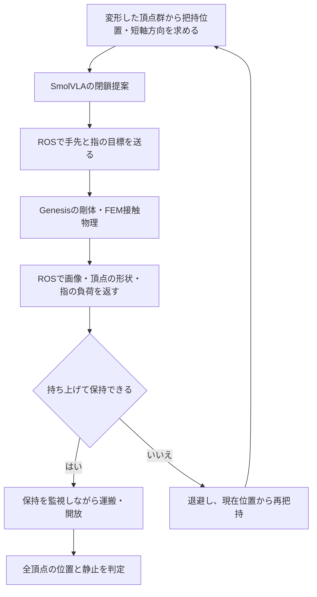

# 柔軟な具材の盛り付け：ROS 2＋Genesis

- [📋 1. 構成](#-1-構成)
- [🚀 2. 実行](#-2-実行)
- [⚙️ 3. 柔軟物と把持](#️-3-柔軟物と把持)
- [📡 4. ROSトピック](#-4-rosトピック)
- [📁 5. 構成と出力](#-5-構成と出力)
- [🧪 6. 検証](#-6-検証)

## 📋 1. 構成

ROS 2で指令と観測を受け渡し、Genesis 1.4.3のFEM弾性体をPandaアームでつかむ。
卵・なるとは変形する体積メッシュ、麺とスープは固定形状。
実食品の物性を計測したモデルではない。

| 要素 | 担当 |
| --- | --- |
| ROS 2 Jazzy・rosbridge 2.7.1 | 指令、画像、腕と具材の状態の通信 |
| Genesis | 剛体の腕、弾性体の具材、両者の接触と描画 |
| SmolVLA | 把持位置での指の閉鎖開始の提案 |
| 補助制御 | 形状に合わせた接近、閉鎖と保持、持ち上げ確認、再把持 |



## 🚀 2. 実行

Python 3.12、uv、Docker、`docker-compose`、H.264対応のffmpegが必要。
Apple GPUと描画機能を利用する場合は通常のTerminalから実行する。

```sh
cd v7-ros-genesis-soft
uv sync --locked
cp -n .env.example .env
command -v ffmpeg
```

`.env` の `FFMPEG_PATH` を表示された絶対パスに合わせる。
`HF_HOME` には既存のSmolVLAキャッシュも指定できる。

Colimaを使用する場合：

```sh
colima start --cpu 4 --memory 4
./run_gpu.command
```

ROSサーバー、Genesis、制御プロセスを順に起動する。
Genesisの初回コンパイルには時間がかかる場合がある。待ち時間は `ROS_TIMEOUT_SECONDS`。
シミュレータのログは `output/simulation-*.log` に保存する。

個別に起動する場合は、ROSサーバーを起動してからTerminalを二つ使う。

```sh
./start_ros.command
# シミュレータ側のTerminal
ROLE=simulation uv run python src/main.py
```

```sh
# 制御側のTerminal
ROLE=controller uv run python src/main.py
```

`POLICY_MODE=mechanics` はAIを使わない機械診断。実モデルを使う場合は `smolvla`。
CPUは `GENESIS_BACKEND=cpu DEVICE=cpu`、GPUは `GENESIS_BACKEND=metal DEVICE=mps`。
Macでは表示を無効にしても描画初期化が必要。

## ⚙️ 3. 柔軟物と把持

全設定は必須で、説明と値は [`.env.example`](.env.example) に記載する。

- **弾性体**：FEMのlinear-corotatedモデル。ヤング率、ポアソン比、質量、減衰を設定する。
- **初期形状**：卵は楕円体、なるとは円柱。表面に色と模様を持つ。
- **接近**：頂点群の短軸を指の開閉方向にし、指先とトレーの間隔を確保する。
- **閉鎖**：AIの提案を待つ上限を設け、その後は補助制御で少しずつ閉じる。
- **接触候補**：左右の指腹の内側面付近に頂点がある状態を3周期確認する。近接だけでは把持成功と判定しない。
- **負荷上限**：指の駆動力が上限を超えたら閉鎖を中断する。この駆動力は、具材との直接の接触力を測定した値ではない。
- **保持確認**：具材の中心が持ち上がり、指付近に保たれることを確認する。
- **運搬**：指腹から具材が離れたら閉じ直し、保持が失われたら再試行する。
- **開放**：丼の縁を越えてから低い位置へ下ろし、指を開く。

`GRIP_LOAD_LIMIT`、`CLOSE_STEP` が指の閉鎖を制御する。
`MAX_COMPRESSION` は目標開き幅、`MAX_DEFORMATION_RMS` は形状変化の制限。
これらは実食品の損傷限界を表す数値ではない。

変形RMSは、初期形状との平行移動・回転の差を除いた頂点位置の差。
把持位置はシミュレータの頂点位置から得る。柔軟物を指へ固定する拘束や、具材座標の直接移動は使わない。

## 📡 4. ROSトピック

ROSサーバーは `127.0.0.1:9091`。v5の9090番とは別のポートを使う。

| トピック | ROS型 | 内容 |
| --- | --- | --- |
| `/ramen_soft/command` | `std_msgs/msg/String` | 要求ID、手先位置・姿勢、指の開き、工程 |
| `/ramen_soft/observation` | `std_msgs/msg/String` | 画像、腕、変形後の形状、把持負荷、配置判定 |
| `/ramen_soft/joint_states` | `sensor_msgs/msg/JointState` | 関節の実測位置 |
| `/ramen_soft/camera/main/compressed` | `sensor_msgs/msg/CompressedImage` | 外部カメラ |
| `/ramen_soft/camera/wrist/compressed` | `sensor_msgs/msg/CompressedImage` | 手首カメラ |
| `/clock` | `rosgraph_msgs/msg/Clock` | シミュレーション時刻 |

Stringの `data` はcamelCaseのJSON。独自トピックはシミュレータ・制御プロセスの実行中に確認できる。

```sh
ROLE=probe uv run python src/main.py
docker-compose exec rosbridge bash -lc 'source /opt/ros/jazzy/setup.bash && ros2 topic list'
docker-compose exec rosbridge bash -lc 'source /opt/ros/jazzy/setup.bash && ros2 topic echo /ramen_soft/joint_states'
```

停止は `docker-compose down`。

## 📁 5. 構成と出力

```text
v7-ros-genesis-soft/
├─ README.md
├─ pyproject.toml
├─ uv.lock
├─ .env.example
├─ .gitignore
├─ .dockerignore
├─ .pre-commit-config.yaml
├─ Dockerfile
├─ compose.yaml
├─ start_ros.command
├─ run_gpu.command
├─ assets/
│  ├─ manifest.json
│  ├─ franka_emika_panda/         # 腕と固定物の形状・利用条件
│  └─ soft_food/                 # 柔軟物の表面メッシュ・模様
├─ input/
│  └─ tasks.json
├─ src/
│  ├─ main.py
│  ├─ pipeline.py                # 役割ごとの実行と記録
│  ├─ recording.py
│  ├─ config/                    # settings.py・logging.py
│  ├─ environment/               # backend.py・genesis_scene.py・scene.py
│  │                             # layout.py・geometry.py・soft_geometry.py・contact.py
│  ├─ experiment/                # assisted.py・messages.py・images.py・observations.py・types.py
│  ├─ policy/                    # smolvla.py
│  └─ ros/                       # bridge.py・remote.py・simulation.py
├─ tools/
│  └─ build_soft_assets.py
└─ tests/                        # 通信・入力・形状・把持の検証
```

各Pythonパッケージには `__init__.py` を含む。
出力は `output/YYYYMMDD-HHMMSS/役割/`。時刻はJST。

| ファイル | 内容 |
| --- | --- |
| `results.json` | AI使用の有無、試行回数、成否、変形量 |
| `settings.json` | モデル・物理・制御の条件 |
| `rollout.mp4` | 制御側が受信した実カメラ画像 |
| `telemetry.jsonl` | 指令、実観測、モデルの提案 |
| `ros_commands.jsonl` | シミュレータが受信した指令 |

`MODEL` はAIの提案、`ASSIST` は把持補助、`RULE` は接近や開放。
`ai_triggered_closure` で、AIの提案によって閉鎖へ進んだかを確認できる。
`contact_kind=vertex_proximity_and_drive_force` は、頂点の近接と駆動力による把持の目安を表す。

## 🧪 6. 検証

```sh
uv run pytest tests -v --cov=src --cov-report=term
uv run ruff format --check src tests tools
uv run ruff check src tests tools
uv run mypy src tests tools --follow-imports=silent
```

単体テストの通信や方策の代役と、実物理・実モデルによる盛り付け結果は区別する。
